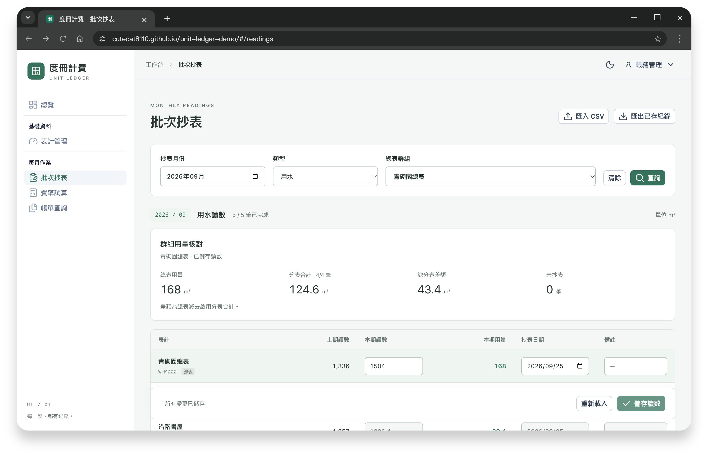
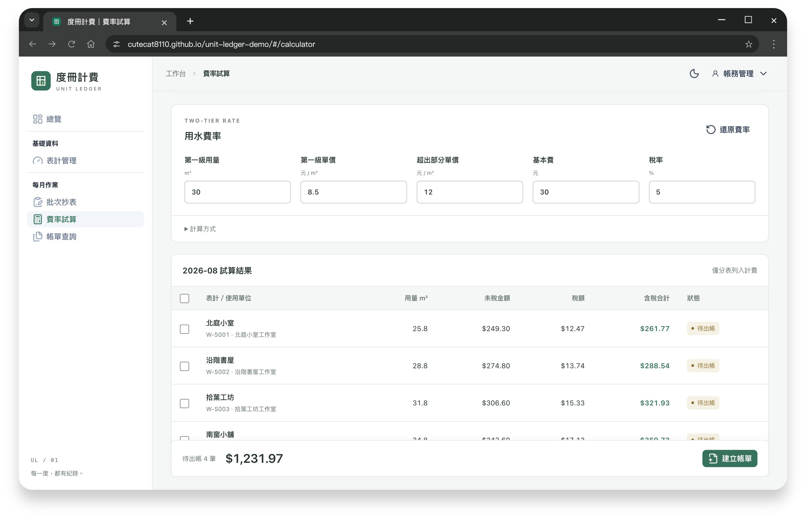
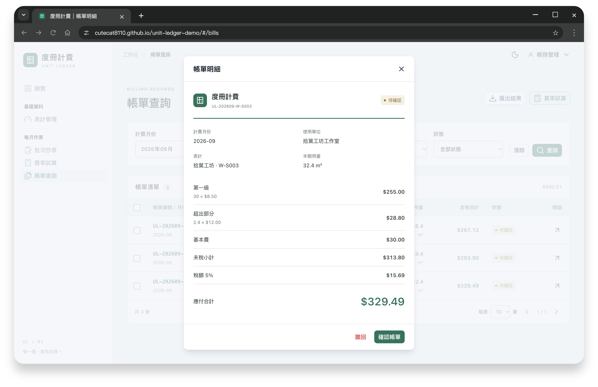

# 度冊計費｜表計與帳務管理展示

    

從每月抄表到帳單核對，清楚追蹤讀數、用量與費用。

**[開啟 Demo](https://cutecat8110.github.io/unit-ledger-demo/)** · 登入頁點鑰匙即可帶入帳密。

| 功能 | 體驗重點 |
| --- | --- |
| [表計管理](https://cutecat8110.github.io/unit-ledger-demo/#/meters) | 總分表關聯、查詢、編修與匯出 |
| [批次抄表](https://cutecat8110.github.io/unit-ledger-demo/#/readings) | CSV 匯入預覽、整批驗證、總分表用量核對 |
| [費率試算](https://cutecat8110.github.io/unit-ledger-demo/#/calculator) | 階梯費率、基本費、稅額與出帳快照 |
| [帳單查詢](https://cutecat8110.github.io/unit-ledger-demo/#/bills) | 明細核對、確認／撤回與 CSV 匯出 |

**試用順序：** 匯入或補登 2026 年 9 月讀數 → 選群組核對用量 → 試算出帳 → 核對明細。

未儲存離頁提醒、修改衝突提示與出帳快照，讓批次操作有跡可循。

帳務管理可編修表計及出帳；抄表作業可登錄讀數、試算與查看帳單。

更多畫面

使用說明

初始資料為合成資料，費率僅供展示。角色權限在前端模擬，資料保存在目前瀏覽器；不提供跨裝置同步、付款或正式帳務串接。右上角「重設資料」可回復初始內容。已確認帳單不可撤回。

CSV 使用頁面提供的 UTF-8 範本；驗證通過後帶入表格，再按「儲存讀數」。用量核對採已存讀數，缺表時不計差額，不自動分攤。

